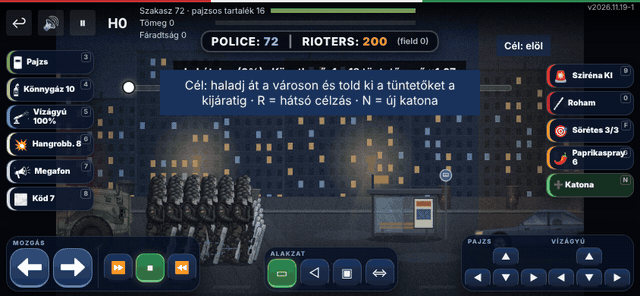
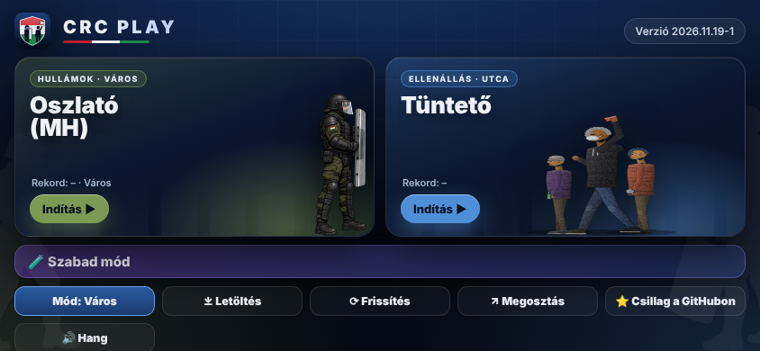
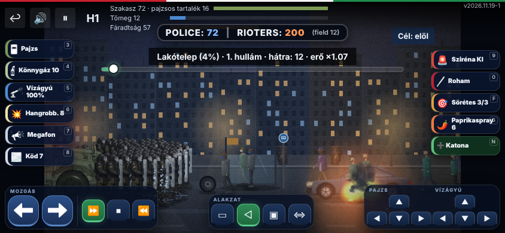
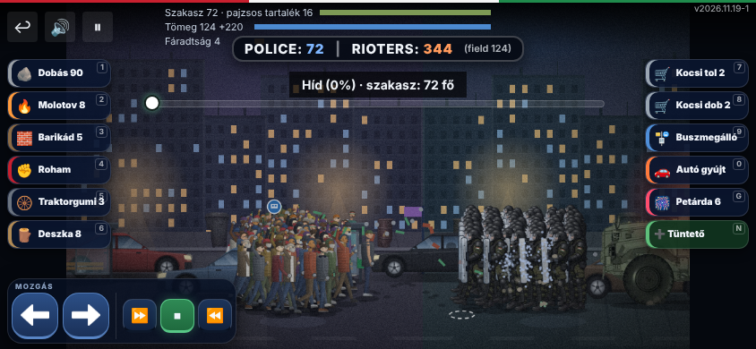

[🇬🇧 English](README.md) · 🇭🇺 Magyar

# CRC PLAY

Oldalnézetes tömegoszlatás-szimuláció böngészőre és Androidra: két játszható oldal, hullámokra épülő városi kampány és szabad mód. Egyetlen HTML-fájl, build lépés nélkül.



[**▶ Játék indítása**](https://crc-military-game.vercel.app/) · [**📱 APK letöltése**](https://github.com/strattila90-hue/crc-military-game/releases/latest/download/CRC-PLAY.apk)

    

## Funkciók

- **Két oldal.** Játssz az *oszlatókkal* (hullámokon át told végig a városon) vagy a *tüntetőkkel* (tartsd a nyomást, törj át a vonalon), plusz **szabad mód** a saját szituációd felépítéséhez.
- **Oszlatók eszközei:** pajzs (kopik, cserélhető), gumibot-roham, könnygáz, hangrobbantó, tehetetlenséggel célozható vízágyú, megafon, alakzatok (vonal / ék / doboz), sörétes, paprikaspray, utánpótlás.
- **Tüntetők eszközei:** kő, tégla, üveg, molotov (mindenki mást tart), barikád, roham, petárda, folyamatos utánpótlás, tárgyak bontása, autók felgyújtása.
- **Élő tömeg:** mindenki saját, egyenetlen megáll-elindul ritmusban mozog; hullámok, hátba támadók, gáz-, füst- és tűzfelhők hatnak rájuk.
- **Irányítás:** billentyűzet, érintőképernyős gombok és kontroller.
- **Telepíthető:** PWA-ként és önálló Android appként, automatikus frissítéssel.

## Képernyőképek





## Futtatás helyben

```bash
git clone https://github.com/strattila90-hue/crc-military-game
cd crc-military-game
python3 -m http.server 8765
# nyisd meg: http://localhost:8765/index.html
```

Billentyűk: nyilak mozgás, Space / 1–9 / 0 akciók, F sörétes, G paprikaspray / petárda, N új ember, P vagy Esc szünet. Pajzs: Z/X/A/D, vízágyú: I/J/K/L.

## Technika

- Natív JavaScript, 2D canvas; az `index.html` tartalmaz minden JS-t, CSS-t és képet (base64 WebP).
- Procedurálisan rajzolt, festett hatású tüntetők (hengeres árnyékolás, 8 fázisú járás térdhajlítással); a katonák festett sprite-ok; az autók egyszer rajzolódnak gyorsítótárazott képre.
- Szintetizált hangok (Web Audio) rezgéssel.
- Android: Capacitor + GitHub Actions; az app a játékfájlt magától frissíti ([részletek](README-APK.md)).

## Közreműködés

Hibabejelentést és pull requestet szívesen fogadunk, lásd [CONTRIBUTING.md](CONTRIBUTING.md).

## Licenc

[MIT](LICENSE)

---

⭐ Ha tetszik, adj neki egy csillagot, sokat segít!
