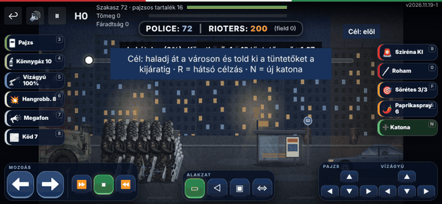
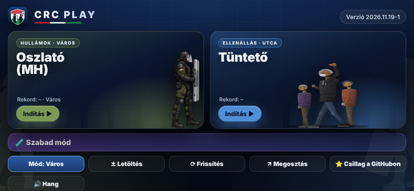
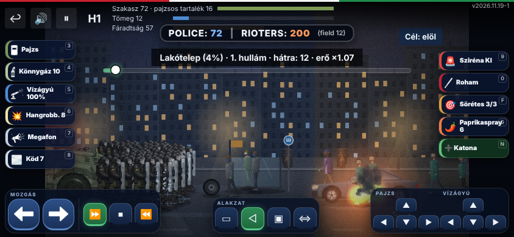
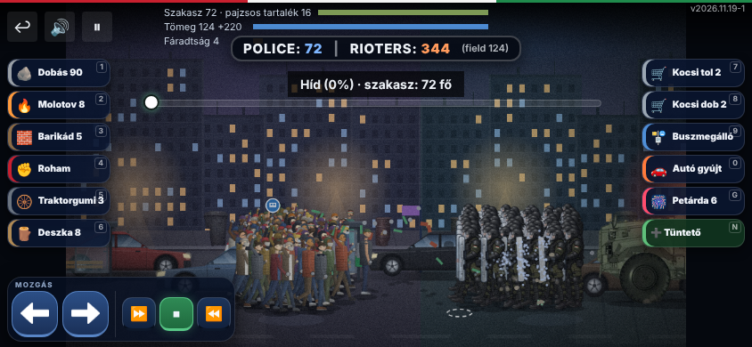

🇬🇧 English · [🇭🇺 Magyar](README.hu.md)

# CRC PLAY

A side-scrolling crowd-control simulation for the browser and Android: two playable sides, a wave-based city campaign, and a sandbox mode. Single HTML file, no build step.



[**▶ Play now**](https://crc-military-game.vercel.app/) · [**📱 Download APK**](https://github.com/strattila90-hue/crc-military-game/releases/latest/download/CRC-PLAY.apk)

    

## Features

- **Two sides.** Play the *dispersal unit* (push through the city in waves) or the *protesters* (hold the pressure and break through the line), plus a **free mode** where you build your own scenario.
- **Unit toolkit:** shield (wears down, swappable), baton charge, tear gas, flash-bang, water cannon with inertial aiming, megaphone, formations (line / wedge / box), shotgun, pepper spray, reinforcements.
- **Protester toolkit:** thrown stones, bricks, bottles and Molotovs (everyone carries something different), barricades, charges, firecrackers, endless resupply, and demolishing props or setting cars on fire.
- **Living crowd:** each person has an uneven stop-and-go rhythm; waves, flanking attackers, gas, smoke and fire clouds all affect them.
- **Controls:** keyboard, on-screen buttons for touch, and gamepad support.
- **Installable:** works as a PWA and as a standalone Android app with in-app updates.

## Screenshots





## Run locally

```bash
git clone https://github.com/strattila90-hue/crc-military-game
cd crc-military-game
python3 -m http.server 8765
# open http://localhost:8765/index.html
```

The UI is currently in Hungarian. Keys: arrows to move, Space / 1–9 / 0 for actions, F shotgun, G pepper spray / firecracker, N new recruit, P or Esc to pause.

## Tech

- Vanilla JavaScript on a 2D canvas, one `index.html` containing all JS, CSS and sprites (embedded base64 WebP).
- Procedurally drawn, painted-style protesters (cylindrical shading, 8-phase walk cycle with knee bend); soldiers use painted sprites; cars are rendered once into cached images.
- Synthesised sound effects (Web Audio) with haptic feedback.
- Android build via Capacitor and GitHub Actions; the app can update its game file over the air ([details](README-APK.md)).

## Contributing

Issues and pull requests are welcome, see [CONTRIBUTING.md](CONTRIBUTING.md).

## License

[MIT](LICENSE)

---

⭐ If you like it, please give it a star — it really helps!
